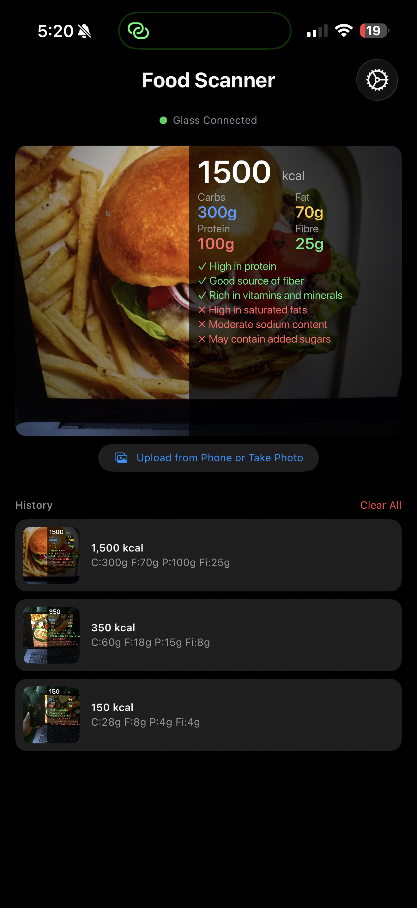
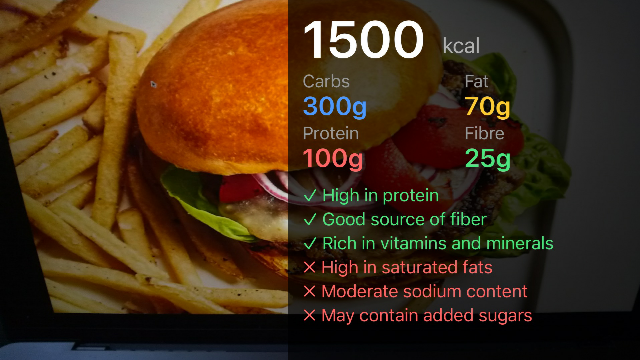
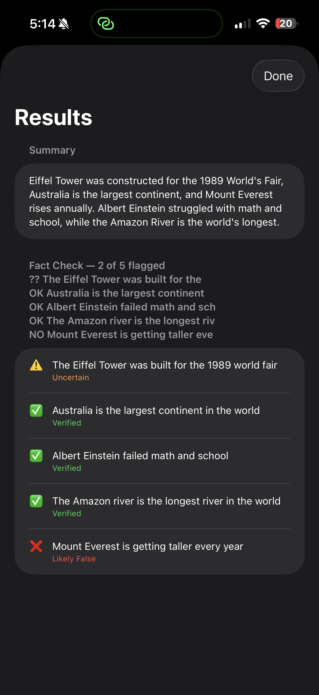
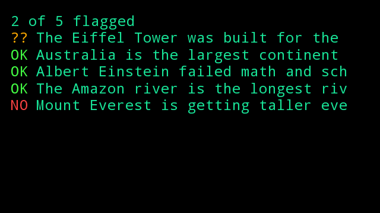

# Scaling Human Experiments

A collection of personal experiments with hardware, AI, apps, games, and local
computing—built to learn, explore, and make useful things for everyday life.

**Personal experimentation, not a commercial offering.** This repository is
maintained for learning and personal use, not as a paid product or subscription
service. Individual experiments may have free App Store apps, personal sideload
builds, source artifacts, or documentation only.

> Human + Machines >> Human | Machines

Created and maintained by
[Srikantha Ballani (@c0smicdirt)](https://github.com/c0smicdirt) as part of
[Scaling Human](https://github.com/scalinghuman).

## Explore the projects

| Project | Experiment | What is available here | Project page |
|---|---|---|---|
| [Food Scanner](docs/projects/foodscanner.md) | AI-assisted nutrition from a food photo | Google Glass companion source and installation guide; iPhone source is separate | [Website](https://scalinghuman.ai/apps/foodscanner) |
| [Glasshole AI](docs/projects/glasshole.md) | Conversation summaries and fact-check overlays | Google Glass companion source and installation guide; iPhone source is separate | [Website](https://scalinghuman.ai/apps/glasshole) |
| [Kids Meal Mode](docs/projects/kids-meal-mode.md) | Timed meal prompts on Fire TV / Android TV | Project documentation and personal/family sideload download; source is private | [Website](https://scalinghuman.ai/apps/streaming-devices-kids-meal-mode) |
| [Book Cricket](docs/projects/book-cricket.md) | A nostalgic page-flip cricket game | Links to the separately maintained project; source is not included here | [Website](https://scalinghuman.ai/apps/book-cricket) |
| [Local AI game experiment](docs/projects/local-ai-game.md) | An offline model builds a browser platformer | Generated game source, README, and test harness | [Website](https://scalinghuman.ai/apps/qwen38-27b-eval) |
| [Ring Local](docs/projects/ring-local.md) | Direct Oura Ring 4 Bluetooth connection to iPhone | Project scope and links; native app and hardware validation pending | [Website](https://scalinghuman.ai/apps/ring-local.html) |
| [Strap Local](docs/projects/strap-local.md) | Direct WHOOP 5.0 Bluetooth connection to iPhone | Project scope and links; native app and hardware validation pending | [Website](https://scalinghuman.ai/apps/strap-local.html) |

## How the collection is organized

Each experiment has a [project brief](docs/projects/README.md) that links to its
existing code, documentation, downloads, and public page. Not every project has
public source in this repository. GitHub Projects boards can track each app's
issues and milestones while the code and release assets remain in their
existing locations.

This is a collection rather than one installable application. Start with an
individual project's page for its scope, status, installation options, and
limitations. The existing [source-available license](LICENSE) governs the
published repository; it is not an unrestricted open-source license.

## Companion Experiments

This repository contains Android companion apps for wearable hardware.

- **Food Scanner** captures a food image and sends it to the companion iPhone
  app for nutrition analysis, then displays the result on the companion
  display.
- **Glasshole AI** is an AI-powered conversation fact-checker. It starts and
  stops real-time conversation capture and displays summaries and fact-check
  overlays returned by the companion iPhone app after analysis.

  Use Glasshole only with the consent of everyone being recorded and in
  compliance with local laws and regulations where it is used.

The free iPhone apps are distributed separately through the Apple App Store.
The iPhone apps also support standalone operation without companion hardware.

## Repository Contents

```text
companions/
  foodscanner-glass-companion/
  glasshole-glass-companion/
docs/glass/
assets/images/
scripts/
```

The private iOS source, App Store submission materials, research papers, and
internal development notes are not published in this repository.

## Supported AI Providers

The iPhone apps let the user choose the processing provider:

- **Glasshole:** Apple Intelligence, xAI Grok, OpenAI, Anthropic Claude, Google
  Gemini, Ollama, PocketPal, or a custom OpenAI-compatible endpoint.
- **Food Scanner:** Local iPhone Vision, xAI Grok, OpenAI, Anthropic Claude,
  Google Gemini/Gemma, Ollama vision models, PocketPal, or a custom endpoint.

Apple Intelligence in Glasshole requires an iPhone 15 Pro model or an iPhone 16
model or later, with Apple Intelligence enabled. Other supported iOS 26 iPhones
must use a configured cloud, local-network, PocketPal, or custom provider.
Food Scanner's default Local iPhone Vision mode works without Apple
Intelligence or an API key.

Get API keys or local runtimes:

- [xAI Grok](https://console.x.ai/)
- [OpenAI](https://platform.openai.com/api-keys)
- [Anthropic Claude](https://platform.claude.com/settings/keys)
- [Google Gemini](https://aistudio.google.com/app/apikey)
- [Ollama](https://ollama.com/download) (no API key)

## Install

See the [Google Glass XE Installation Guide](docs/glass/GLASS_INSTALL_GUIDE.md)
for ADB installation, networking, and how to launch companions with a
**touchpad tap** on the **fact check** or **scan food** Glass commands.

Do **not** rely on saying “Ok Glass” — use the touchpad.

Product pages (download APK + link to this guide):

- [Food Scanner](https://scalinghuman.ai/apps/foodscanner)
- [Glasshole AI](https://scalinghuman.ai/apps/glasshole)

The companion apps target Android 4.4.4 / API 19 and are sideloaded.

## Screenshots

### Food Scanner





### Glasshole





## Status

Experimental. AI nutrition estimates and fact-check results can be wrong and must
not be treated as medical advice or authoritative fact.

Source is available under the
[Scaling Human Source-Available License](LICENSE). Redistribution, commercial
use, hosted derivatives, and app-store publication require written permission.
